<div align="center">

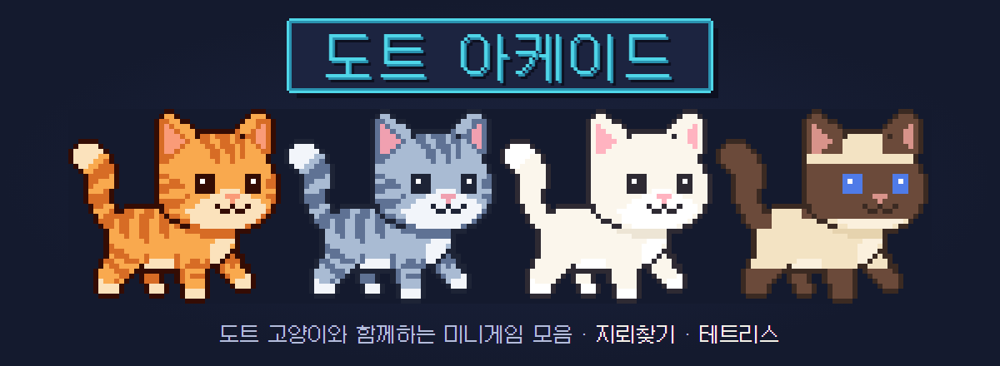


고양이를 고르면 게임 옆에서 **표정과 말풍선으로 반응**하고, 그 고양이의 상징색이 **UI 테마**가 됩니다.

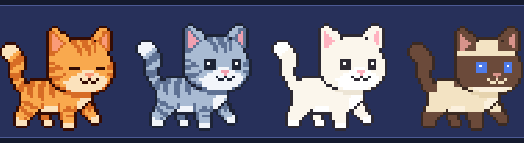

</div>

---

## 특징

|                              |                                                                                                                                                              |
| ---------------------------- | ------------------------------------------------------------------------------------------------------------------------------------------------------------ |
| **게임 4종 + 플러그인 구조** | 지뢰찾기(초급 · 중급 · 고급), 테트리스(레벨 1 · 5 · 10), 오목(2인 대전 · 컴퓨터 쉬움/어려움), 스네이크(느긋 · 보통 · 빠름). 새 게임은 폴더 하나 + 등록 한 줄 |
| **마스코트**                 | 치즈 · 고등어 · 우유 · 샴 — 표정 7종 + 식빵 자세. 게임 상황(연쇄 · 위험 · 실패 · 신기록 …)에 캐릭터별 대사로 반응                                            |
| **도트 디자인 시스템**       | 모든 치수가 디자인 픽셀 단위, DPR 보정으로 어떤 화면에서도 도트가 번지지 않음. Galmuri 픽셀 폰트, 칩튠 효과음(WebAudio 합성)                                 |
| **기록**                     | 난이도별 BEST · 플레이/클리어율 · 최근 10판 · 신기록 연출 (localStorage)                                                                                     |
| **설정**                     | 효과음/볼륨 · CRT 스캔라인 · UI 크기 · 마스코트 수다 · 움직임 줄이기 · 테트리스 DAS/ARR                                                                      |
| **반응형 + 터치**            | PC 키보드/마우스 우선, 좁은 화면은 스트립 레이아웃 + 터치 조작 바                                                                                            |

## 화면

<table>
  <tr>
    <td align="center"><b>타이틀</b></td>
    <td align="center"><b>캐릭터 선택</b></td>
  </tr>
  <tr>
    <td>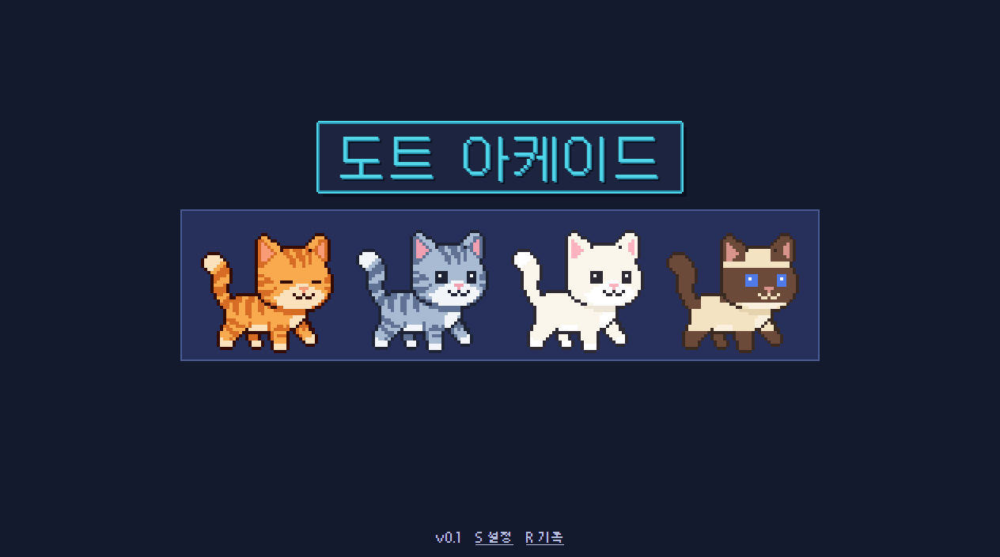</td>
    <td>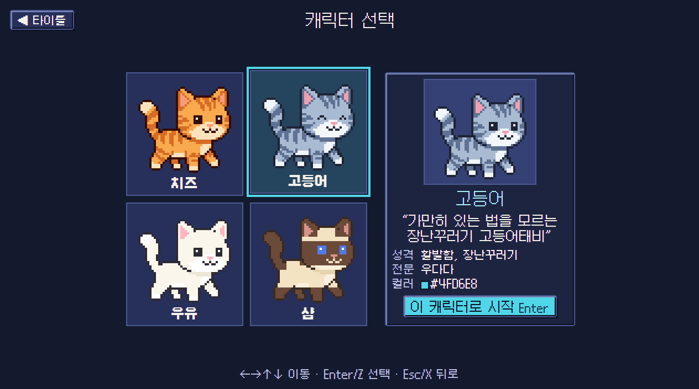</td>
  </tr>
  <tr>
    <td align="center"><b>로비</b></td>
    <td align="center"><b>지뢰찾기</b></td>
  </tr>
  <tr>
    <td>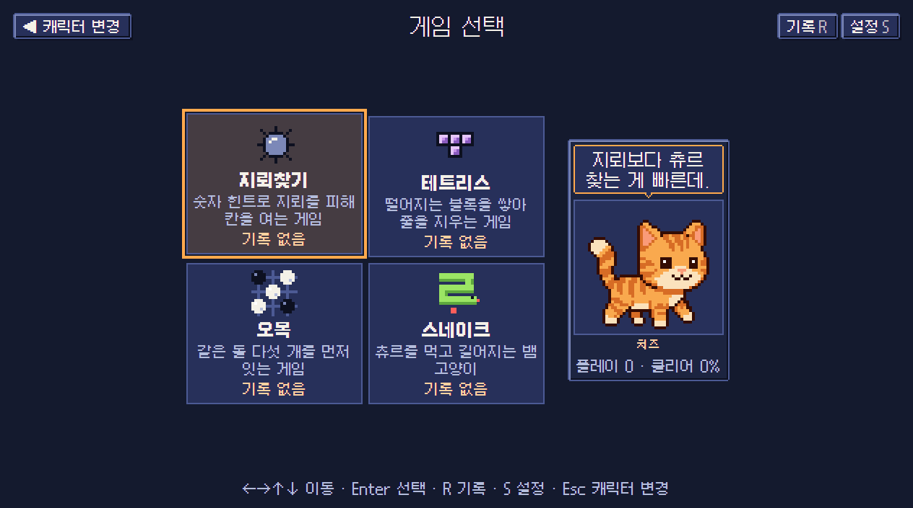</td>
    <td>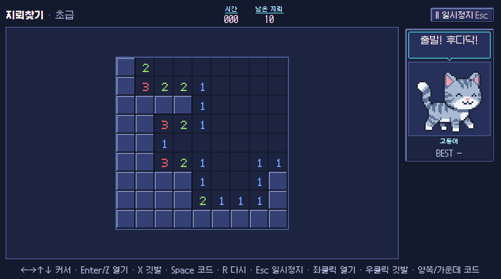</td>
  </tr>
  <tr>
    <td align="center"><b>테트리스</b></td>
    <td align="center"><b>오목 (2인 대전)</b></td>
  </tr>
  <tr>
    <td>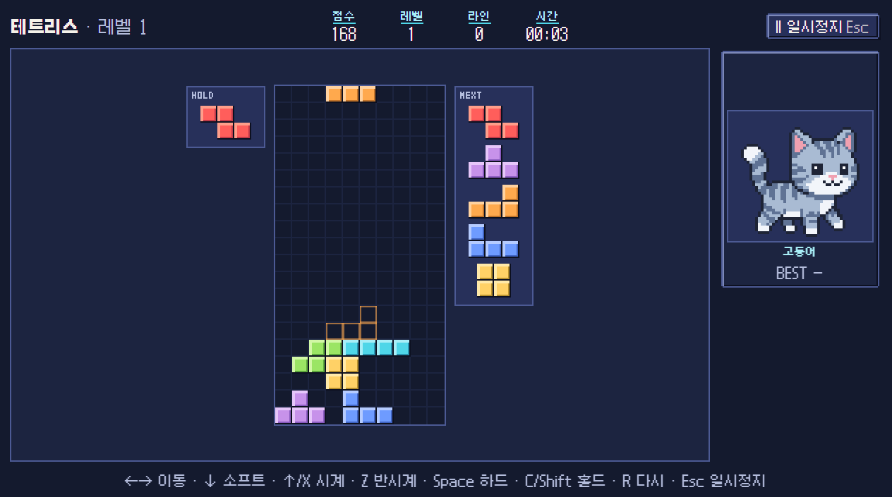</td>
    <td>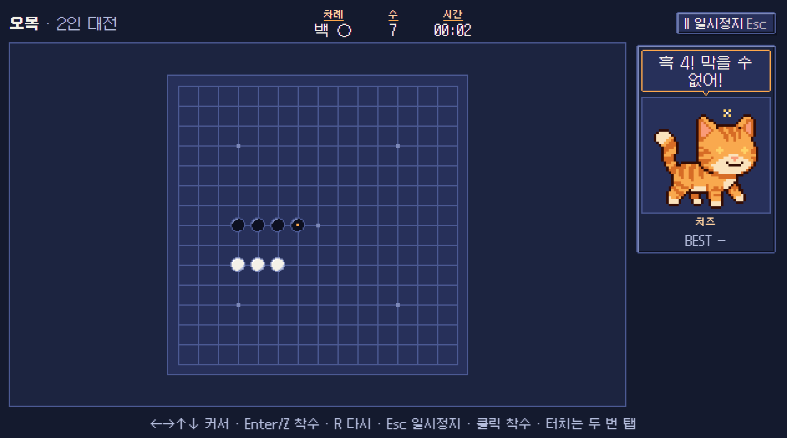</td>
  </tr>
  <tr>
    <td align="center"><b>스네이크</b></td>
    <td align="center"><b>기록</b></td>
  </tr>
  <tr>
    <td>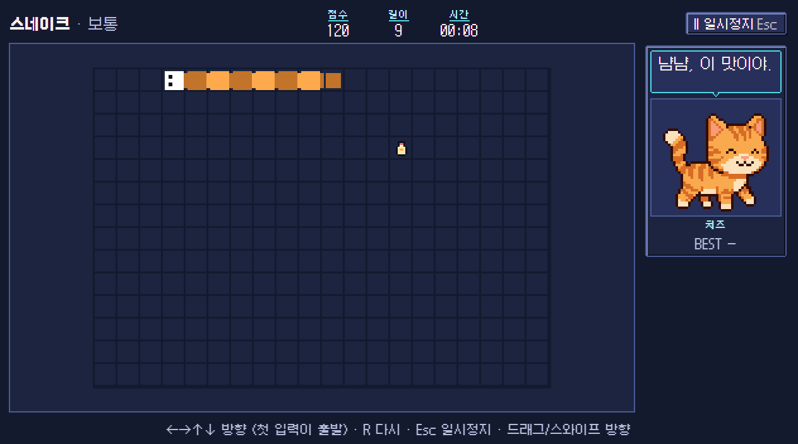</td>
    <td>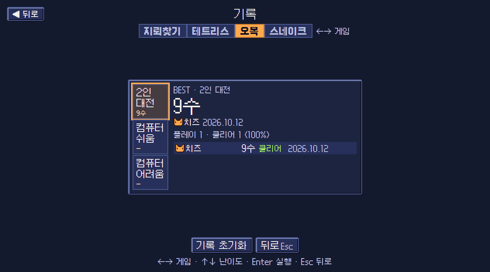</td>
  </tr>
  <tr>
    <td align="center"><b>설정</b></td>
    <td align="center"><b>모바일 (390×844)</b></td>
  </tr>
  <tr>
    <td>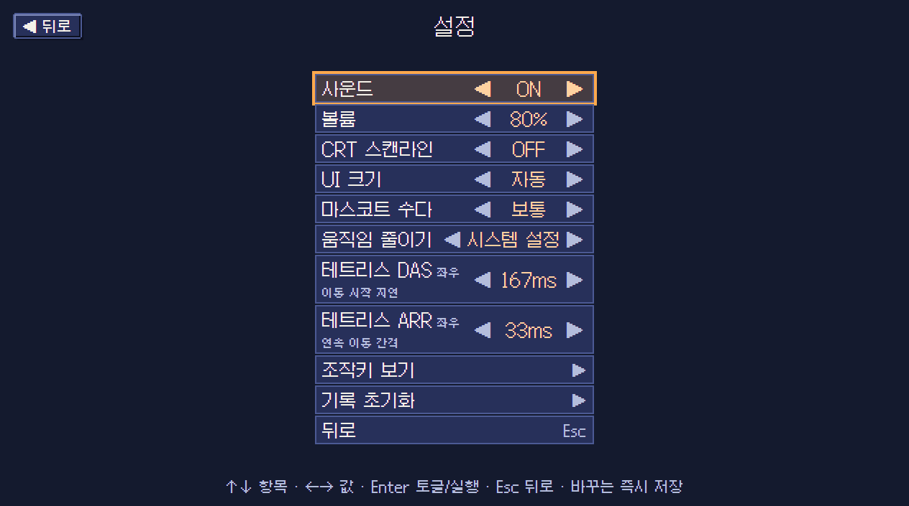</td>
    <td align="center">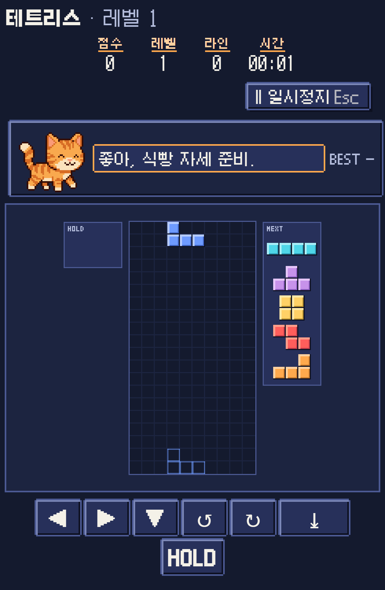</td>
  </tr>
</table>

## 🐈 캐릭터

<table>
  <tr>
    <td>
      <table>
        <tr><th></th><th>이름</th><th>종류</th><th>성격</th><th>테마색</th></tr>
        <tr><td>🟠</td><td><b>치즈</b></td><td>치즈태비</td><td>먹보, 느긋함</td><td>주황</td></tr>
        <tr><td>🔵</td><td><b>고등어</b></td><td>고등어태비</td><td>활발함, 장난꾸러기</td><td>하늘</td></tr>
        <tr><td>🩷</td><td><b>우유</b></td><td>흰 고양이</td><td>수줍음, 다정함</td><td>분홍</td></tr>
        <tr><td>💙</td><td><b>샴</b></td><td>샴</td><td>도도한 츤데레, 늘 졸림</td><td>파랑</td></tr>
      </table>
    </td>
    <td align="center">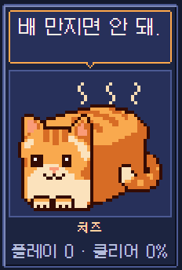<br><sub>로비에서 12초 가만히 두면 식빵을 굽습니다</sub></td>
  </tr>
</table>

네 마리는 같은 도트 템플릿(걷는 포즈 42×39, 식빵 46×34)의 팔레트·무늬 변형이고, 캐릭터마다 대사표가 따로 있습니다. 능력치 차이는 없습니다.

**표정 7종** — 기본 · 기쁨 · 걱정 · 슬픔 · 승리 · 생각 · 식빵

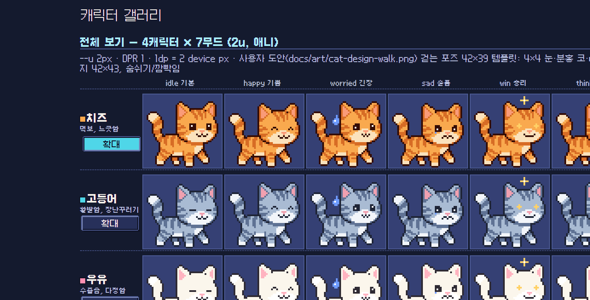

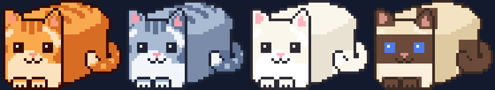

## 실행

```bash
npm install
npm run dev        # http://localhost:5173
npm run check      # 타입 검사 + 린트(oxlint) + 테스트(vitest)
npm run build      # dist/ — 상대 경로라 아무 정적 호스팅에 올리면 됨
npm run preview
```

Node 20 이상. React 19 · Vite 8 · TypeScript · zustand · Galmuri 폰트.

개발 빌드 전용 진입점: `#dev/gallery`(표정 전체) · `#dev/tokens`(디자인 토큰) · `#go/<title|select|lobby|records|settings>`(화면 바로 열기) · `?touch=1`(터치 바 강제 표시).

## 조작

| 키                | 메뉴                        | 지뢰찾기                                     | 테트리스                              | 오목                                 | 스네이크                  |
| ----------------- | --------------------------- | -------------------------------------------- | ------------------------------------- | ------------------------------------ | ------------------------- |
| ←→↑↓              | 포커스 이동                 | 커서 이동                                    | ←→ 이동 · ↓ 소프트 드롭 · ↑ 시계 회전 | 커서 이동                            | 방향 (첫 입력이 출발)     |
| Enter / Z / Space | 확인                        | Enter·Z 열기 · Space 코드                    | Z 반시계 · Space 하드 드롭            | 착수 (커서가 안 보이면 먼저 표시)    | —                         |
| Esc / X           | 뒤로 · 닫기                 | Esc 일시정지 · X 깃발                        | Esc 일시정지 · X 시계 회전            | Esc 일시정지                         | Esc 일시정지              |
| C / Shift · R · S | — · 기록(로비) · 설정       | — · 재시작                                   | 홀드 · 재시작                         | — · 재시작                           | — · 재시작                |
| 마우스            | hover = 포커스, 클릭 = 확인 | 좌클릭 열기 · 우클릭 깃발 · 양쪽/가운데 코드 | —                                     | hover 미리보기 · 클릭 착수           | 드래그 = 방향             |
| 터치              | —                           | 탭 열기 · 길게 눌러 깃발 · 깃발 모드 토글    | 화면 아래 버튼 (DAS 지원)             | 첫 탭 커서 · 같은 곳 두 번째 탭 착수 | 스와이프 · 화면 아래 ◀▲▼▶ |

테트리스는 모던 가이드라인을 따릅니다: SRS 회전 + 월킥, 7-bag, Next 5, 홀드, 고스트, 락 딜레이 500ms(최대 15회 리셋), B2B · 콤보 보너스, DAS/ARR 조절.

오목은 15×15 자유룰(같은 돌 5개 이상이면 승리)입니다. **2인 대전**은 한 화면에서 번갈아 두고, **컴퓨터** 모드는 내가 흑(선공)입니다. 컴퓨터는 모든 줄의 5칸 창을 세어 열린 3 · 막힌 3 · 띈 3 · 완성점을 평가하고, 쉬움은 1수 평가 상위 3수 중 무작위, 어려움은 후보 8수를 깊이 4 알파베타로 읽습니다(수당 평균 7ms, 자기대국에서 어려움이 쉬움을 20전 20승). 기록은 이긴 판의 최단 수.

스네이크는 20×14 격자에서 츄르를 먹을 때마다 한 칸씩 길어지고, 먹이 5개마다 빨라집니다(최소 60ms). 속도 단계(느긋 · 보통 · 빠름)가 그대로 점수 배수(×1 · ×2 · ×3)입니다.

## 구조

```
src/
├─ app/        스토어(persist) · 화면 상태 머신 · 입력 서비스 · 오디오(칩튠 레시피) · 마스코트 리액터 · 기록 병합 · 루프
├─ pixel/      코드로 정의하는 도트 스프라이트 → 래스터 → 캔버스 캐시
├─ characters/ 고양이 템플릿 · 얼굴 타일 · 대사표 · 4종 정의
├─ games/      types.ts(게임 ↔ 셸 계약) · registry.ts · host.ts · minesweeper/ · tetris/ · omok/ · snake/ · sample/
├─ ui/         React 화면/컴포넌트/훅/스타일 (전역 토큰 + CSS Modules)
└─ lib/        rng · fit · canvas · format · math
docs/          계획서(00) · 아키텍처(01) · 디자인 시스템(02) · 게임 스펙(03) · 추가 게임(04) · art/ 캐릭터 도안 · screenshots/
```

핵심 규칙

- **게임 모듈은 React를 모른다.** `games/types.ts`의 `GameModule` / `GameInstance` / `GameHost` 계약만 쓰고, 로직은 순수 함수가 의미 이벤트(`reveal`, `clear`, `lost` …)를 돌려주면 `index.ts`가 효과음 · 마스코트 · HUD로 매핑합니다. 로직은 전부 결정적 난수로 테스트됩니다.
- **마스코트는 의미 이벤트에만 반응한다.** 게임은 `game.good`, `game.risky` 같은 이벤트만 던지고, 표정 · 우선순위 · 쿨다운은 `app/mascot.ts` 한 곳, 대사는 캐릭터 파일이 정합니다. 게임을 추가해도 캐릭터 코드는 건드리지 않습니다.
- **1dp = `--u` CSS px.** DPR 보정으로 항상 정수 디바이스 픽셀이라 도트가 번지지 않습니다. 게임 캔버스도 논리 크기만 선언하면 프레임이 정수 배율로 띄웁니다.

## 새 게임 추가

1. `src/games/sample/`을 복사해 `GameModule`을 구현합니다 — 논리 캔버스 크기, 난이도(모드 선택에도 씀), HUD 항목, 채점 규칙(`betterIs`, `countsWhen`), 조작 설명, 터치 버튼, `create(host)`. 결과창 문구를 바꾸려면 `host.finish()`에 `title` · `tone` · `scoreLabel`을 넘깁니다(오목의 "흑 승리!").
2. `src/games/registry.ts`의 `GAMES`에 한 줄 추가하면 로비 카드 · 난이도 피커 · 기록 화면에 자동으로 나타납니다. 카드 아이콘은 `src/games/icons.ts`에 16×16 스프라이트로.
3. 캐릭터 파일의 `lobby:<gameId>` 대사를 채우면 로비에서 그 게임을 가리킬 때 말합니다. 게임 전용 대사가 더 필요하면 `registerGameLines(gameId, {...})`.

## 문서

- [docs/00-plan.md](docs/00-plan.md) — 개발 계획과 단계별 산출물
- [docs/01-architecture.md](docs/01-architecture.md) — 아키텍처
- [docs/02-design-system.md](docs/02-design-system.md) — 팔레트 · 타이포 · 픽셀 UI 기법 · 캐릭터 · 효과음 레시피
- [docs/03-game-specs.md](docs/03-game-specs.md) — 지뢰찾기 · 테트리스 상세 규칙과 테스트 목록
- [docs/04-extra-games.md](docs/04-extra-games.md) — 오목(AI 평가 · 모드) · 스네이크 설계와 단계

## 도안

`docs/art/`의 캐릭터 도안(걷는 포즈, 식빵 자세)은 이 프로젝트 소유자가 제작한 원본이며, `src/characters/template.ts`는 그 도안을 픽셀 격자로 샘플링해 정리한 것입니다. 폰트는 [Galmuri](https://galmuri.quiple.dev/)(SIL OFL)입니다.
